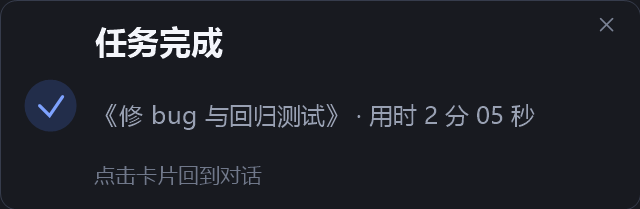

# dsh-turn-notifier（任务完成提醒）

你去干别的事，DSH 里的任务跑完时，屏幕右下角弹一张卡片、响一声——不用一直盯着页面。



> 只想看怎么用、出问题怎么查 → 看 [使用手册.md](使用手册.md)。本文件面向开发者，讲实现与安装细节。

## 行为

- **什么时候提醒**：任意会话的回合结束时（宿主把该会话的 `running` 从 `true` 改成 `false`）。
- **什么时候不提醒**：DSH 窗口在最前面时不弹卡片（你正看着答案），内部子代理会话结束也不提醒。
- **提醒长什么样**：右下角一张深色卡片，标题「任务完成」，正文「《会话标题》 · 用时 2 分 05 秒」，点卡片会把 DSH 窗口拿到前台；15 秒后自动消失，鼠标停在上面时不倒计时。卡片固定大小（640×209）；一行放不下时标题折两行并省略，**用时永远完整显示**。
- **什么时候不提醒**：子代理会话结束（`origin === 'subagent'`），那些是内部步骤，父会话的结果才是你要看的。
- **窗口最小化时**：另外把网页标题改成 `🔔 任务完成`，任务栏上能看见；回到窗口自动还原。

## 为什么不用 Windows 系统通知

这台机器的系统通知通道是关死的，任何应用（包括本应用）都弹不出来：

- `HKCU\Software\Microsoft\Windows\CurrentVersion\PushNotifications\ToastEnabled = 0`（系统级关闭）；
- 应用主进程从未 `setAppUserModelId`，也没有 AUMID 条目，用 PowerShell 注册 AUMID 并 `CreateToastNotifier(...).Show()` 时调用不报错，但屏幕上什么都不出现，`Notifications\Settings` 下也从不新增子键。

所以提醒改成自己画：宿主半侧 `spawn` 一个短命的 PowerShell 进程，用 WinForms 画卡片（`lib/card.ps1`）。这条路在这台机器上已实测可见。

## 实现要点

- **宿主半侧** `index.js`：`ctx.on('api-session/status', ...)` 跟踪每个会话的 running 状态，`true → false` 时算用时、用 `ctx.get('sessionQuery').readTitleSnapshot(sessionId)` 取标题、`showCard()` 起卡片。
  - 事件契约：`api-session/status` 与官方 `ui-session-status` 插件订阅的是同一个 Remote 事件（其白名单在 `dsh-api-remotes/src/remote-events.ts`），无需轮询。
  - 子进程**不能** `detached: true`：它会跟着本进程的 job object 一起被杀掉，卡片永远不出现。
  - 脚本经 UTF-8（带 BOM）临时文件 + `Invoke-Expression` 交接：`-EncodedCommand` 的 base64 会让命令行超长（`spawn ENAMETOOLONG`），而本机执行策略禁止直接跑 `.ps1` 文件，所以要读成文本再执行。
- **卡片** `lib/card.ps1`：
  - 尺寸固定为 640×209，每次提醒占的屏幕一样大；
  - 正文一行放得下就单行显示（在预留的两行高度里垂直居中），放不下就折两行——标题允许截断加省略号，用时作为独立的一段右对齐放在第二行，永远完整；
  - 无控制台的进程第一次 `ShowWindow` 会沿用隐藏，所以 `Show()` 之后要显式 `ShowWindow(hwnd, SW_SHOWNOACTIVATE)` + `SetWindowPos(HWND_TOPMOST, SWP_SHOWWINDOW)`；
  - 整张卡片一次性画进 Bitmap，`Paint` 里只 `DrawImageUnscaled`——直接往窗体上画字，在首次绘制时会被整块跳过；
  - emoji（✅ 之类）在 `Graphics.DrawString` 里会整行消失，所以对勾是画出来的图形，不是字符；
  - 屏幕缩放 200% 时按物理像素布局，脚本开头先 `SetProcessDPIAware()`。
- **浏览器半侧** `client.js`：纯副作用插件，只做标题标记；`inject: ['sessions', 'remote']`，监听都挂在 `ctx.effect` 里由清理函数回收，卸载/热重载不残留。

## 安装状态（这台机器）

已经装进 `desktop` profile：

- `~/.dsh/profiles/desktop/package.json` 的 `dsh.profile.bundles` 里有 `dsh-turn-notifier`；
- 依赖写成了 `link:C:/Users/HJYS/Desktop/杂项/dsh-turn-notifier`，所以改本目录的文件后，重载插件条目（插件管理页关一下再开）或重启 DSH 就生效，不用重新安装。

## 自测

```
cd dsh-turn-notifier
node test/smoke.mjs                      # 浏览器半侧：11 项
node dev/card-selftest.mjs               # 真弹一次卡片，并让它自己截图
node dev/card-selftest.mjs --preview     # 只渲染卡片外观到 preview.png
```

`test/smoke.mjs` 用 vm 造一个假的 `window/document` 跑 `client.js`，覆盖：后台结束标记标题、可见时不标记、子代理不标记、加载基线不误报、重复事件不重复、focus/点击/可见性变化还原、卸载后监听清零。

## 目录

插件的全部代码、测试、以及开发时用的小工具都在这个目录里：

```
dsh-turn-notifier/
├── package.json         # dsh.bundle / dsh.client 清单
├── cordis.patch.yml     # 往插件树里插入 turn-notifier 这一条
├── index.js             # 宿主半侧：监听状态、起卡片
├── lib/card.ps1         # 卡片脚本（PowerShell + WinForms）
├── client.js            # 浏览器半侧：标题标记
├── icon.svg             # 插件列表里的图标
├── preview.png          # 卡片外观（README 里的图）
├── 使用手册.md           # 给用户看的：怎么用、没弹怎么查
├── test/smoke.mjs       # 离线冒烟测试
└── dev/                 # 查 DSH 源码 / 预览卡片用（DSH 不加载，见 dev/README.md）
    ├── asar-index.cjs
    ├── asar-extract.cjs
    ├── asar-grep.cjs
    ├── ctx-grep.cjs
    └── card-selftest.mjs
```

## 已知边界

- DSH 完全退出时不会提醒（进程没了）；重新打开后会话状态还在。
- 只提醒"回合结束"，不提醒"等你批准/回答"这类中间停顿。
- 多个会话同时结束会各弹一张卡片。
