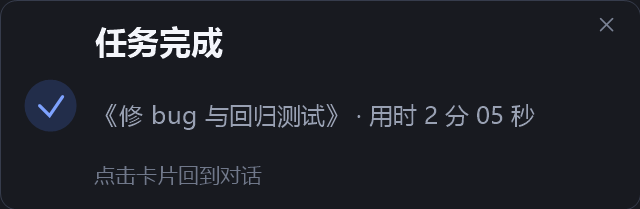

# 任务完成提醒 · 使用手册

一句话：**DSH 里的任务跑完时，屏幕右下角弹一张卡片、同时响一声**，这样你不用坐在电脑前盯着页面。

装好就生效，没有开关、没有设置项，也不需要你做什么。

---

## 1. 你要做的

什么都不用做。

照常派活，然后切到别的窗口、最小化 DSH，甚至去看视频。任务结束时卡片会自己弹出来。

## 2. 什么时候会弹

| 情况 | 会弹吗 |
| --- | --- |
| 你去了别的窗口 / 最小化了 DSH，任务跑完 | ✅ 会 |
| DSH 还在前台，你在看**另一个**会话，这个会话跑完 | ✅ 会 |
| 任务跑完时 DSH 窗口就在最前面（你正看着它） | ❌ 不会（答案就在眼前，不打扰你） |
| 内部子任务（子代理）跑完 | ❌ 不会（等父任务整轮结束时才弹） |
| 任务中途停下来等你批准 / 等你回答 | ❌ 不会（这类停顿属于已知边界） |
| DSH 被完全退出 | ❌ 不会有（进程都没了） |

## 3. 卡片长什么样

右下角一张深色小卡片：

- 标题「任务完成」，正文是「《会话标题》 · 用时 1 分 20 秒」；
- 卡片是固定大小的：标题太长会折成两行、超出的部分用省略号——但**「用时 …」永远完整显示**；
- 右下角同时响一声系统提示音；
- **点一下卡片**：DSH 窗口跳到前台（回到你刚才那个会话的方向）；
- **点右上角 ✕**：立刻关掉；
- 不理它，15 秒后自己消失；鼠标停在卡片上时不会倒计时；
- 窗口最小化时，任务栏上的网页标题还会变成 `🔔 任务完成`，回到窗口自动还原。

## 4. 30 秒自测

1. 随便让我跑一个十几秒的任务（比如"数到 10，每数一下停 1 秒"）；
2. 切到别的窗口，或者最小化 DSH，等它结束；
3. 右下角应该弹卡片、响一声。

## 5. 没弹？按这个顺序查

1. **先确认本来该不该弹**：子代理结束、或 DSH 已经退出，本来就没有卡片（见第 2 节）。
2. **窗口是不是在别的虚拟桌面 / 全屏游戏里**：全屏独占时卡片可能被压在后面，退出全屏再看。
3. **卡片被别的东西挡住了**：它总在最上层，但屏幕右下角若有其他置顶窗口（录屏、输入法状态窗）可能重叠。
4. 还不行就打开 `Ctrl+Shift+I` → Console，看有没有这两行：
   - `[turn-notifier] 任务完成提醒已启用` —— 有，说明插件加载了；没有就是没加载（去插件管理页确认 `dsh-turn-notifier` 是开着的，然后重启 DSH）。
   - 顺带看一眼有没有 `[turn-notifier] 提醒窗口启动失败：...`，有的话把报错发我。

> 说明：这台机器**系统通知是关闭的**（Windows 设置里 `ToastEnabled = 0`，且本应用没有注册应用 ID），所以不再走系统通知，而是自己画卡片——不依赖系统那个开关。

## 6. 不想用了

- **临时关**：左侧栏「插件」→ 已安装插件 → 关掉 `dsh-turn-notifier`（或「设置 → 插件管理」打开同一页），重启 DSH 生效。
- **彻底删**：在上面那页点移除，然后删掉 `C:\Users\HJYS\Desktop\杂项\dsh-turn-notifier` 目录。
- **只想静音**：Windows 音量合成器里把 `Windows PowerShell` 那条调低——卡片还会弹，但不出声。

## 7. 想改点什么

- **卡片文案**：`lib/card.ps1` 里标题是 `'@@HEADING@@'`（由 `index.js` 传 `任务完成`），正文在 `index.js` 的 `report()` 里拼。
- **停留时长**：`index.js` 顶部 `AUTO_CLOSE_MS = 15000`。
- **卡片尺寸 / 配色 / 字号**：`lib/card.ps1` 顶部的 `$width`/`$height`/`$radius` 和几个 `FromArgb(...)` 颜色、`New-Object System.Drawing.Font(...)` 字号。
- 改完先预览：`node dev/card-selftest.mjs --preview`（生成 `preview.png`），满意了再去插件管理页把插件关一下再开（或重启 DSH）。

## 8. 已知边界

- 多个会话同时结束，会各弹一张卡片（各自 15 秒）。
- 只提醒"整轮结束"，不提醒"等你批准 / 等你选方案"这类中途停顿。
- DSH 退出时不会有提醒。
- 锁屏状态下卡片会在解锁后继续存在到超时。
